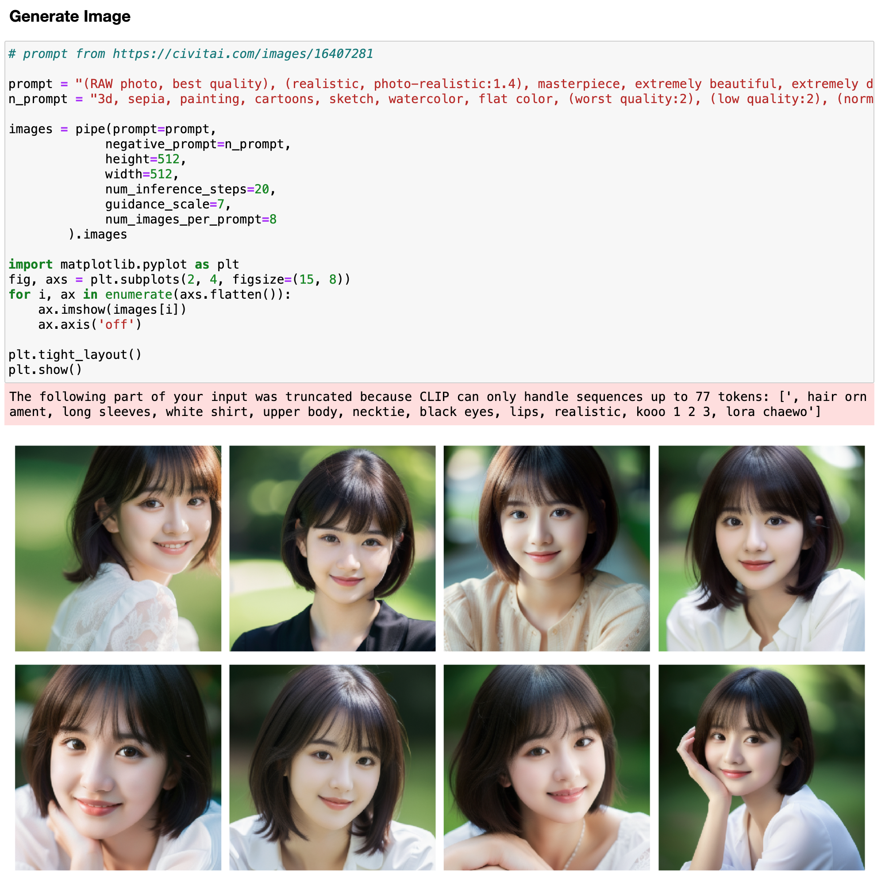
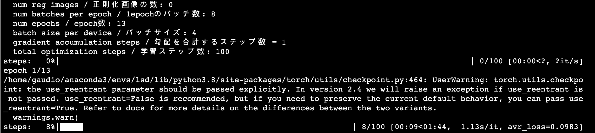
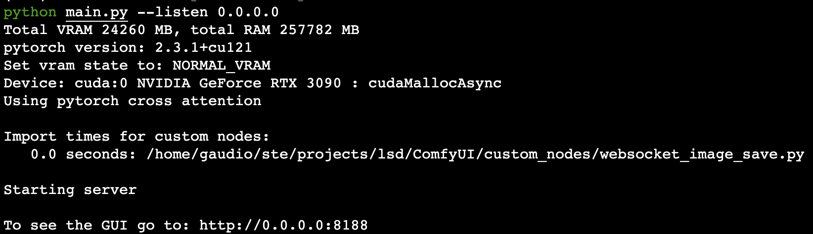

# Learning Stable Diffusion

Hands-on notebooks and workshop materials for understanding diffusion models, adapting them to new data, and building image-generation workflows.

[Start here](docs/setup.md) · [Notebooks](diffusers-example/) · [Lecture slides](slide/)


*The repository's ComfyUI example: from prompt and latent noise to a generated image.*

## Learn by building

| Track | What is inside | Entry point |
| --- | --- | --- |
| **Sampling fundamentals** | Compact DDPM and Flow Matching implementations | [DDPM](diffusers-example/ddpm%20in%20100%20lines.ipynb) · [Flow Matching](diffusers-example/flow%20matching%20in%20100%20lines.ipynb) |
| **Inside Stable Diffusion** | Text encoding, U-Net, scheduling, sampling, and VAE decoding | [Step-by-step notebook](diffusers-example/stable%20diffusion%20step-by-step.ipynb) |
| **Model adaptation** | LoRA, DreamBooth, full fine-tuning, textual inversion, and ControlNet examples | [Training examples](sd-scripts-example/) |
| **Visual workflows** | ComfyUI setup and a notebook for running its code | [ComfyUI examples](ComfyUI-example/) |

## Getting started

Start with the [setup guide](docs/setup.md) to initialize the required submodules, install the supplied dependencies, and download the example checkpoint. Run the [Diffusers pipeline notebook](diffusers-example/stable%20diffusion%20by%20diffusers.ipynb) before moving on to the component-by-component walkthrough.

The examples use CUDA, local model/data paths, and historical package versions. Setup details, the original 100-step LoRA command, and ComfyUI instructions are kept together in the guide.

## Tools and sources

The workshop uses [Diffusers](https://github.com/huggingface/diffusers), [sd-scripts](https://github.com/kohya-ss/sd-scripts), [ComfyUI](https://github.com/comfyanonymous/ComfyUI), and [guided-diffusion](https://github.com/openai/guided-diffusion). See [.gitmodules](.gitmodules) for the source repositories; their licenses and attribution remain with the respective projects.

<details>
<summary>Full project notes</summary>

<!-- preserved-project-notes:start -->
# 실습 환경 설정

## 0. Repository 다운로드

```bash
git clone https://github.com/scpark20/learning_stable_diffusion.git lsd
cd lsd
git submodule update --init --recursive sd-scripts
git submodule update --init --recursive ComfyUI
```


## 1. Diffusers 작동 확인

#### - requirements 파일로 package 설치

```bash
# In lsd directory
pip install -r diffusers-example/requirements.txt
```

#### - checkpoint 다운로드 (/data 디렉토리가 존재해야 함)
```bash
# In any directory
mkdir -p /data/sd_files/checkpoint
wget -P /data/sd_files/checkpoint https://storage.googleapis.com/scpark20_lsd/beautifulRealistic_v7.safetensors
```

#### - Jupyter Notebook 파일 실행하여 동작 확인
```bash
diffusers-example/stable diffusion by diffusers.ipynb
```


## 2. SD-Scripts 작동 확인

#### - requirements 파일로 package 설치
```bash
# In lsd directory
pip install -r sd-scripts-example/requirements.txt
```

#### - data 다운로드 (/data 디렉토리가 존재해야 함)
```bash
# In any directory
mkdir -p /data/sd_dataset
wget -P /data/sd_dataset https://storage.googleapis.com/scpark20_lsd/jisoo_png.zip
unzip /data/sd_dataset/jisoo_png.zip -d /data/sd_dataset
```

#### - .toml 파일 만들기
```bash
# In lsd/sd-scripts directory
mkdir toml
cp ../sd-scripts-example/lora/jisoo_lora.toml toml/
```

#### - accelerate 설정하기
```bash
# In any directory
accelerate config
```

#### - 다음과 같이 입력
```bash
In which compute environment are you running?
➔ this machine
Which type of machine are you using?
➔  No distributed training
Do you want to run your training on CPU only?
➔ NO
Do you wish to optimize your script with torch dynamo?
➔ NO
Do you want to use DeepSpeed?
➔ NO
What GPU(s) (by id) should be used for training on this machine as a comma-seperated list?
➔ 원하는 GPU id 입력
Would you like to enable numa efficiency?
➔ NO
Do you wish to use FP16 or BF16 (mixed precision)?
➔  fp16
```

#### - Training 하기

```bash
# In lsd/sd-scripts directory
accelerate launch --num_cpu_threads_per_process 1 train_network.py \
    --pretrained_model_name_or_path="/data/sd_files/checkpoint/beautifulRealistic_v7.safetensors" \
    --dataset_config=toml/jisoo_lora.toml \
    --output_dir=/data/sd_results/jisoo_lora \
    --output_name=jisoo_lora \
    --save_model_as=safetensors  \
    --max_train_steps=100 \
    --learning_rate=1e-4  \
    --optimizer_type="AdamW"  \
    --mixed_precision="fp16"  \
    --gradient_checkpointing \
    --network_module=networks.lora
```



#### 100 steps 트레이닝 후 /data/sd_results/jisoo_lora/jisoo_lora.safetensors 파일이 생기면 완료

## 3. ComfyUI 작동 확인

#### - requirements 파일로 package 설치

```bash
# In lsd directory
pip install -r ComfyUI-example/requirements.txt
```

#### - checkpoint 파일 symbolic link 만들기

```bash
# In lsd/ComfyUI directory
ln -s /data/sd_files/checkpoint/beautifulRealistic_v7.safetensors models/checkpoints/beautifulRealistic_v7.safetensors
```

#### - ComfyUI 실행
```bash
# In lsd/ComfyUI directory
python main.py --listen 0.0.0.0
```

#### - 웹브라우저에서 server ip:8188 열기


#### - Load Checkpoint Component에서 beautifulRealistic_v7 checkpoint 선택 후 Queue Prompt 버튼 눌러서 이미지 생성이 되면 완료


<!-- preserved-project-notes:end -->

</details>
