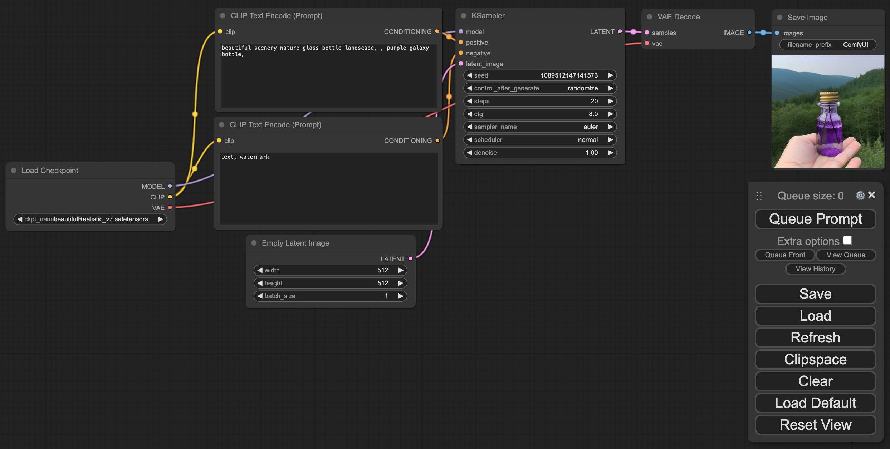

# Learning Stable Diffusion

Hands-on notebooks and workshop materials for understanding diffusion models, adapting them to new data, and building image-generation workflows.

[Start here](docs/setup.md) · [Notebooks](diffusers-example/) · [Lecture slides](slide/)

*The repository's ComfyUI example: from prompt and latent noise to a generated image.*

## Learn by building

| Track | What is inside | Entry point |
| --- | --- | --- |
| **Sampling fundamentals** | Compact DDPM and Flow Matching implementations | [DDPM](diffusers-example/ddpm%20in%20100%20lines.ipynb) · [Flow Matching](diffusers-example/flow%20matching%20in%20100%20lines.ipynb) |
| **Inside Stable Diffusion** | Text encoding, U-Net, scheduling, sampling, and VAE decoding | [Step-by-step notebook](diffusers-example/stable%20diffusion%20step-by-step.ipynb) |
| **Model adaptation** | LoRA, DreamBooth, full fine-tuning, textual inversion, and ControlNet examples | [Training examples](sd-scripts-example/) |
| **Visual workflows** | ComfyUI setup and a notebook for running its code | [ComfyUI examples](ComfyUI-example/) |

## Getting started

Start with the [setup guide](docs/setup.md) to initialize the required submodules, install the supplied dependencies, and download the example checkpoint. Run the [Diffusers pipeline notebook](diffusers-example/stable%20diffusion%20by%20diffusers.ipynb) before moving on to the component-by-component walkthrough.

The examples use CUDA, local model/data paths, and historical package versions. Setup details, the original 100-step LoRA command, and ComfyUI instructions are kept together in the guide.

## Tools and sources

The workshop uses [Diffusers](https://github.com/huggingface/diffusers), [sd-scripts](https://github.com/kohya-ss/sd-scripts), [ComfyUI](https://github.com/comfyanonymous/ComfyUI), and [guided-diffusion](https://github.com/openai/guided-diffusion). See [.gitmodules](.gitmodules) for the source repositories; their licenses and attribution remain with the respective projects.
