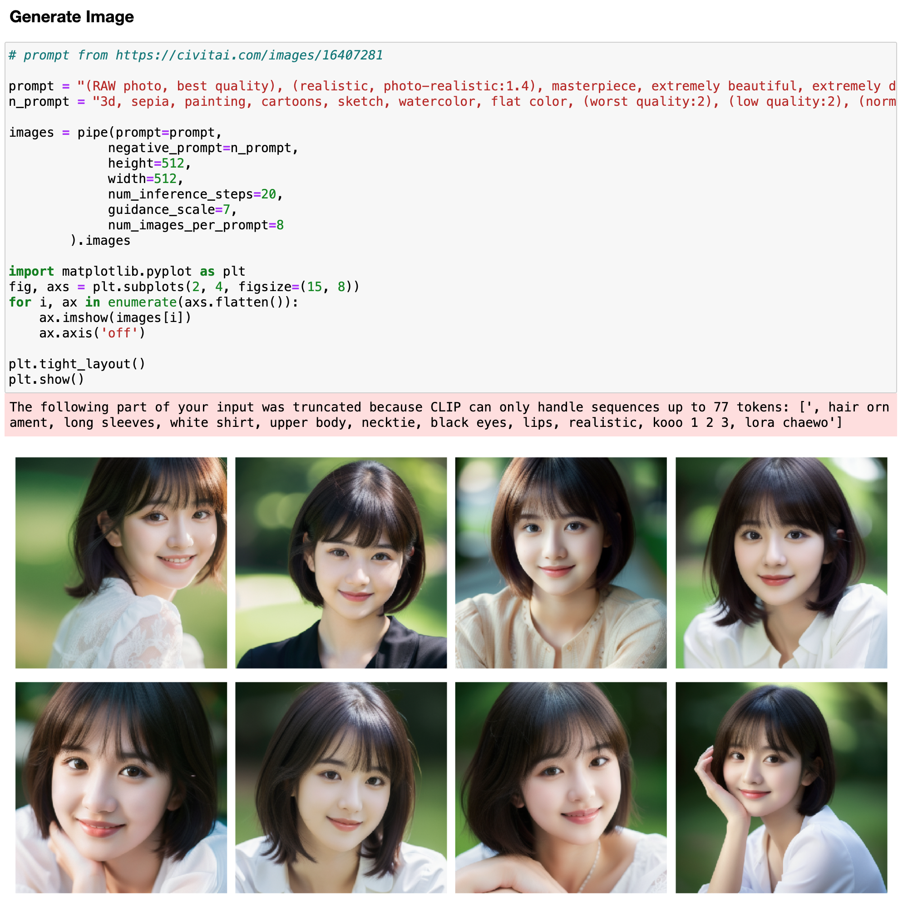
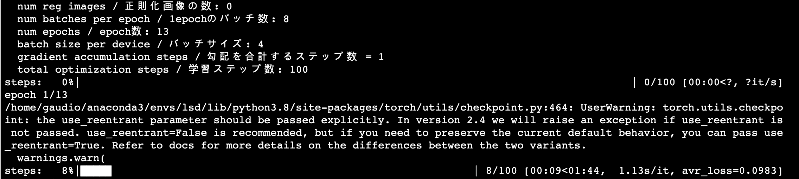
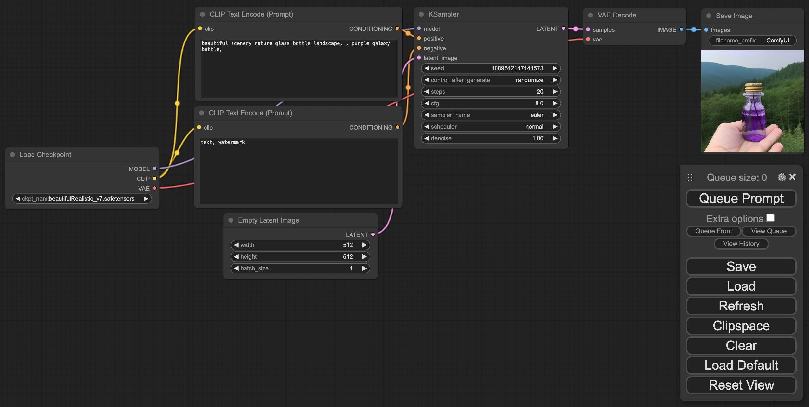

# Workshop setup

[← Back to the project](../README.md)

These instructions preserve the repository's workshop paths, checkpoint, and LoRA example. They target the CUDA-based environment used by the notebooks. Use the supplied requirements for each workflow; they are historical version pins, not a guarantee of compatibility with the latest Python or GPU stack.

## 1. Clone and initialize the tools

```bash
git clone https://github.com/scpark20/learning_stable_diffusion.git lsd
cd lsd
git submodule update --init --recursive sd-scripts ComfyUI
```

The repository also references `diffusers` and `guided-diffusion` as submodules. Initialize those separately if you work with their source examples.

## 2. Run a Diffusers notebook

From the repository root:

```bash
pip install -r diffusers-example/requirements.txt
mkdir -p /data/sd_files/checkpoint
wget -P /data/sd_files/checkpoint https://storage.googleapis.com/scpark20_lsd/beautifulRealistic_v7.safetensors
```

Open [stable diffusion by diffusers.ipynb](../diffusers-example/stable%20diffusion%20by%20diffusers.ipynb) in Jupyter. The notebooks use CUDA and the checkpoint path above. If `/data` is unavailable or not writable, choose another location and update the matching notebook and configuration paths.



## 3. Train the LoRA example

Install the training requirements and download the example dataset from the repository root:

```bash
pip install -r sd-scripts-example/requirements.txt
mkdir -p /data/sd_dataset
wget -P /data/sd_dataset https://storage.googleapis.com/scpark20_lsd/jisoo_png.zip
unzip /data/sd_dataset/jisoo_png.zip -d /data/sd_dataset
cd sd-scripts
mkdir -p toml
cp ../sd-scripts-example/lora/jisoo_lora.toml toml/
accelerate config
```

For the original single-GPU setup, select the local machine, no distributed training, GPU execution, and `fp16`. Choose your GPU ID; leave Torch Dynamo, DeepSpeed, and NUMA optimization disabled.

Run from `sd-scripts/`:

```bash
accelerate launch --num_cpu_threads_per_process 1 train_network.py \
    --pretrained_model_name_or_path="/data/sd_files/checkpoint/beautifulRealistic_v7.safetensors" \
    --dataset_config=toml/jisoo_lora.toml \
    --output_dir=/data/sd_results/jisoo_lora \
    --output_name=jisoo_lora \
    --save_model_as=safetensors \
    --max_train_steps=100 \
    --learning_rate=1e-4 \
    --optimizer_type="AdamW" \
    --mixed_precision="fp16" \
    --gradient_checkpointing \
    --network_module=networks.lora
```

The example configuration uses 512-pixel resolution and batch size 4. After a successful run, check for `/data/sd_results/jisoo_lora/jisoo_lora.safetensors`.



## 4. Run ComfyUI

From the repository root:

```bash
pip install -r ComfyUI-example/requirements.txt
cd ComfyUI
ln -s /data/sd_files/checkpoint/beautifulRealistic_v7.safetensors models/checkpoints/beautifulRealistic_v7.safetensors
python main.py
```

Open the local address printed by ComfyUI, select `beautifulRealistic_v7.safetensors` in **Load Checkpoint**, and use **Queue Prompt** to generate an image. For the original remote-server workflow, start with `python main.py --listen 0.0.0.0` and connect to the server's port `8188`.



The checkpoint and dataset above are external workshop resources. If their availability changes, use a compatible resource and update all corresponding paths.
